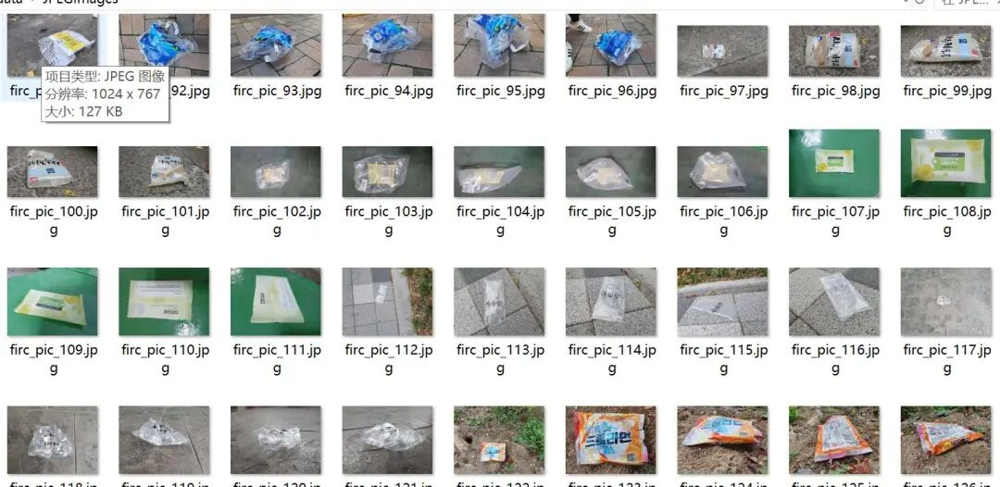
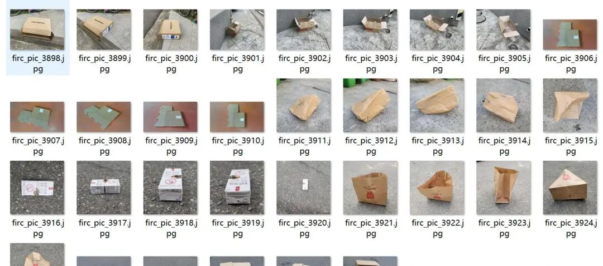
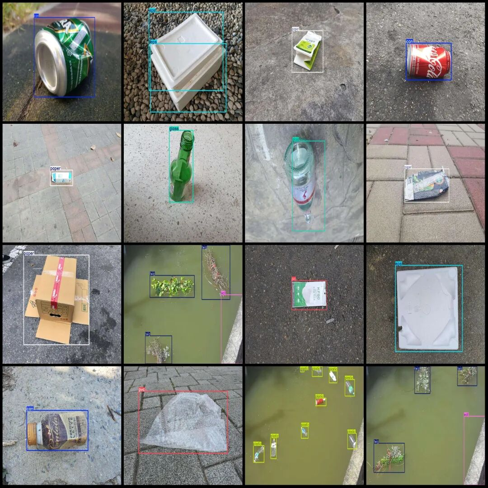
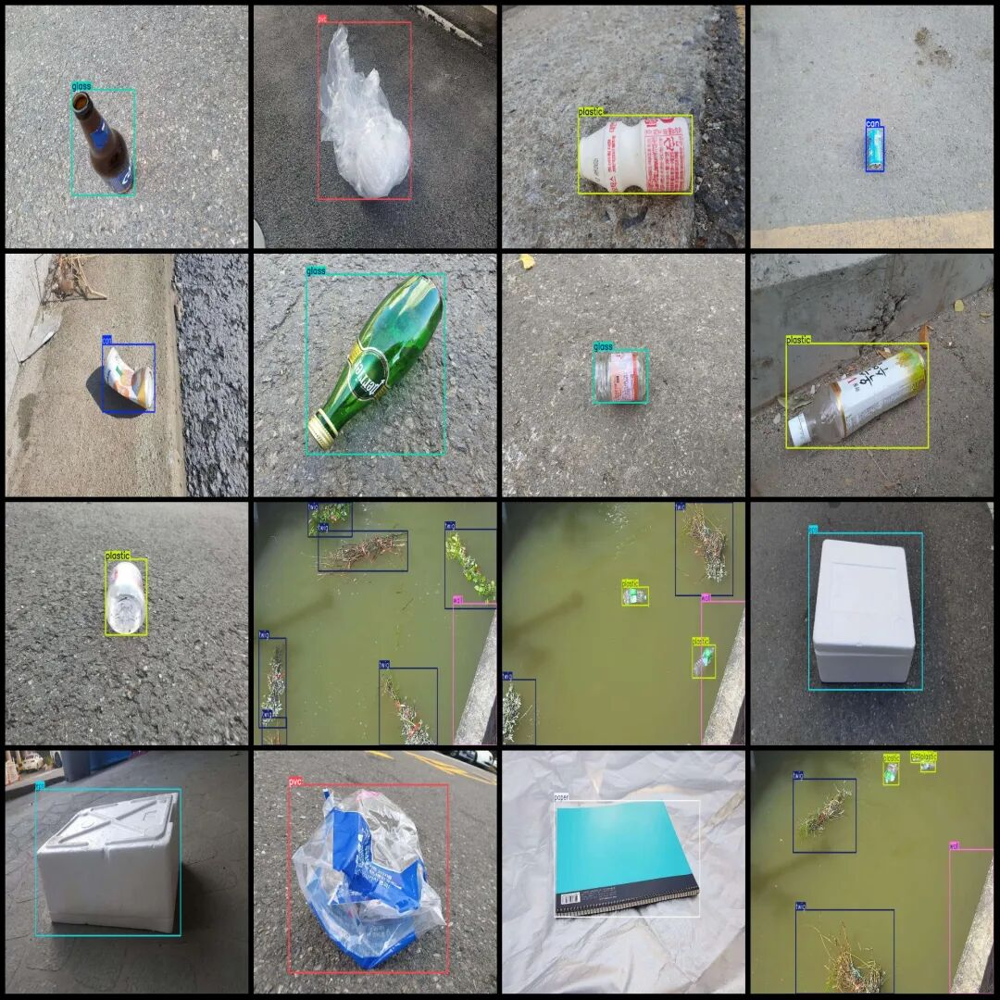

# Plastic Branch Paper Glass Polyethylene Detection Dataset in VOC+YOLO format with 8797 images and 9 categories

Dataset format: Pascal VOC format + YOLO format (txt file without split path, only containing jpg images and corresponding VOC format xml files and yolo format txt files)

Number of images (number of jpg files): 8797

Number of annotations (number of xml files): 8797

Number of annotations (number of txt files): 8797

Label category count: 9

Label category names (note that the order of yolo format categories does not correspond to this, but is based on the labels folder's classes.txt): ["can", "eps", "etc", "glass", "paper", "plastic", "pvc", "twig", "wall"]

Number of boxes labeled in each category:

Can (metal can) frame count = 1343

EPS (foam plastic) frame count = 1437

etc (Other) Frame Count = 129

Number of glass (glass) frames = 1383

Paper (paper) Frames = 1397

Plastic (plastic) frame count = 3071

PVC (Polyvinyl Chloride) frame count = 1329

twig (branch) frame count = 2566

Wall (wall) Frame Count = 782

Total frame count: 13437

Image resolution: Multi-resolution images, such as 1024x768, 1024x576, etc.

Using labelImg:

Annotation rules: Draw a rectangle around the category.

Important Notice: No

Special : This dataset does not guarantee the accuracy of the trained models or weight files.

Image Preview:

Annotation example:

## Payment

Here is a pay link on Stripe ( https://buy.stripe.com/3cs8yP7sY87d0vu9AB ). Please contact me lonlonago@foxmail.com after funding $89, and I will send you a complete data files , thank you!

